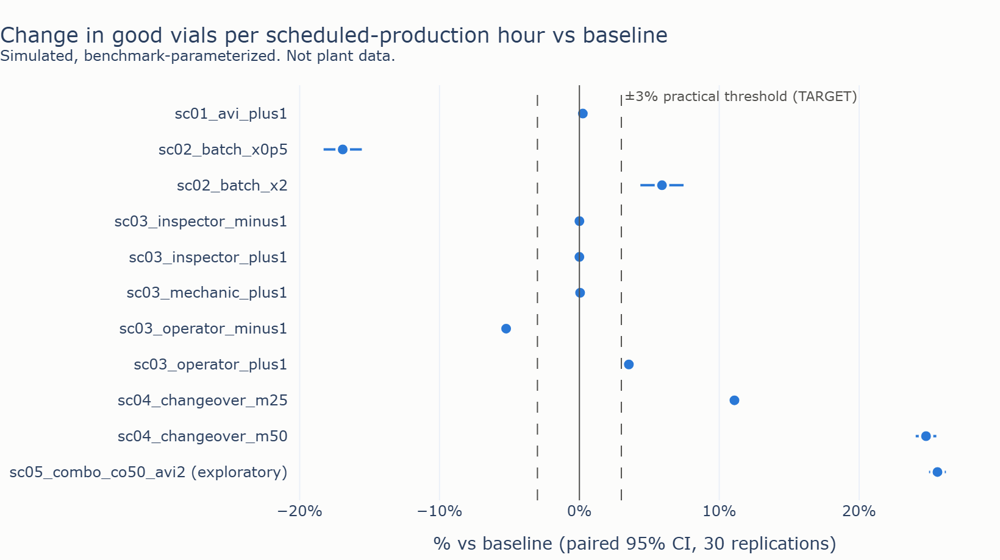
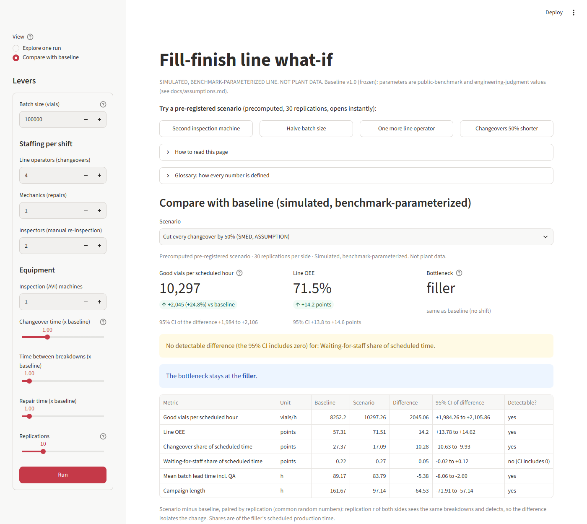

# Pharma Fill-Finish Digital Twin

<!-- Generated from docs/portfolio/README.template.md and reports/results_final.json by
     `python -m ffdt.experiments.final`. Edit the template, not this file. -->

**A simulation of a sterile vial fill-finish line that finds what limits output and ranks improvement options with confidence intervals.** On the simulated line the filler is the constraint and changeovers take 27% of its scheduled time, so cutting changeover time in half raises good output by 24.8% (95% CI 24.0% to 25.5%), while adding a second inspection machine has no significant effect. Every number on this page is a RESULT from a **simulated, benchmark-parameterized** line, not plant data; the single source is [`reports/results_final.json`](reports/results_final.json).



**What-if app:** run `python tasks.py app` locally (see How to run); it lets a non-technical user change batch size, staffing, equipment and changeover time, see OEE, throughput, losses and queue times, and compare any option with the baseline (paired 95% CIs, bottleneck shift).

<details><summary>App screenshot (baseline at the default 10 replications, so its numbers differ slightly from the 30-replication results above)</summary>



</details>

## Problem
Sterile fill-finish lines are capital-intensive and tightly regulated, and the usual improvement questions (buy another inspection machine? run bigger batches? add staff? invest in faster changeovers?) are often answered with averages that ignore queues, blocking and shared staff. This project builds a discrete-event model of a liquid-vial line to answer those questions the way an operations team would want them answered: find the constraint first, then compare options against a frozen baseline with honest uncertainty.

## Method
- **Line modeled:** vial washer → depyrogenation tunnel → filler/stopperer → capper → automated visual inspection (AVI, with an offline manual re-inspection pool) → labeler → cartoner → QA batch release. Finite buffers between stations, so starvation and blocking emerge rather than being assumed.
- **Entities:** sub-lots of 100 vials (ADR-001), with quality drawn per vial inside each sub-lot.
- **Losses:** random breakdowns (operation-dependent), minor stops, product/format changeovers by station scope, fill-weight and AVI rejects, staff waits (operators for changeovers, mechanics for repairs, inspectors for re-inspection), shift calendar of 2 × 8 h × 5 days.
- **Metrics:** OEE = Availability × Performance × Quality per station and for the line (referenced to the filler); loss Pareto by the six big losses; batch cycle and lead time including QA release. Definitions are binding in [`docs/domain/glossary.md`](docs/domain/glossary.md).
- **Parameters:** every value traces to [`data/raw/benchmark_sources.csv`](data/raw/benchmark_sources.csv) or is tagged as engineering judgment ([`docs/assumptions.md`](docs/assumptions.md)).
- **Experiment design:** terminating simulation of a 6-batch weekly campaign, 30 replications, common random numbers (each scenario replication shares its random streams with the matching baseline replication). Scenarios, metrics and decision rules were **pre-registered** in [`docs/scenario_matrix.md`](docs/scenario_matrix.md) before any scenario ran.
- **Statistics:** paired t-test and 95% CI on per-replication differences, percentile bootstrap cross-check, Holm adjustment across the 10 main comparisons; practical significance is a TARGET of +3% good vials per scheduled hour.
- **Bottleneck:** four methods (utilization, Roser-style active period, blocking/starvation arrows, queue build-up); the constraint is an output, never an input.

## Results (simulated, benchmark-parameterized)
**Baseline v1.0:** line OEE 57.3% (95% CI 56.4% to 58.2%), 8,252 good vials per scheduled-production hour, mean batch lead time 89 h including QA release. Changeovers are the largest loss (27% of the filler's scheduled time), followed by the filler being blocked by downstream stations (10%). Full report: [`reports/baseline.md`](reports/baseline.md).

**Constraint:** the **filler**, by all 4 bottleneck methods, in the baseline and in every scenario. It is the sole bottleneck 62% of scheduled time; the cartoner is a secondary, shifting bottleneck. Details: [`reports/bottleneck.md`](reports/bottleneck.md).

**Scenarios** (change in good vials per scheduled-production hour vs baseline, paired 95% CI):

| Option | Set | Effect (95% CI) | Holm-adjusted p | Practically significant (size ≥ 3%)? |
|---|---|---|---|---|
| Changeover -50% plus second AVI (exploratory) | exploratory | +25.6% (+25.0% to +26.2%) | n/a | yes |
| Cut every changeover by 50% (SMED, ASSUMPTION) | main | +24.8% (+24.0% to +25.5%) | <0.001 | yes |
| Cut every changeover by 25% (SMED, ASSUMPTION) | main | +11.1% (+10.8% to +11.4%) | <0.001 | yes |
| Merge identical neighbouring batches (4 batches) | main | +5.9% (+4.4% to +7.4%) | <0.001 | yes |
| One more line operator | main | +3.5% (+3.0% to +4.0%) | <0.001 | yes |
| Add a second AVI machine | main | +0.2% (-0.1% to +0.6%) | 0.85 | no |
| One more mechanic | main | +0.1% (+0.0% to +0.1%) | 0.92 | no |
| One fewer manual inspector | main | +0.0% (+0.0% to +0.0%) | 0.92 | no |
| One more manual inspector | main | +0.0% (+0.0% to +0.0%) | 0.92 | no |
| One fewer line operator | main | -5.2% (-5.6% to -4.9%) | <0.001 | yes |
| Halve batch size (12 x 50,000 vials) | main | -16.9% (-18.3% to -15.6%) | <0.001 | yes |

**What to do first:** a SMED changeover-reduction project across the whole line, then one more line operator; keep batches large where the schedule allows. Plant-manager memo with reasoning and limits: [`reports/scenario_findings.md`](reports/scenario_findings.md). Five-slide summary: [`docs/portfolio/slides.pdf`](docs/portfolio/slides.pdf).

**What the pre-registered hypotheses got wrong:** H2b, H3a and H4a were refuted in whole or in part. Example: an extra operator helped although the filler almost never waited for staff, because the waits were at the packaging end (cartoner 13% of its time). Halving batch size lengthened lead time instead of shortening it, because QA release became the queue.

## Verification and validation
- **Verification:** 246 automated tests, including vial conservation at every instant, state-time accounting, determinism and common-random-number isolation, and analytical checks against M/M/1, M/M/1/K and availability theory (largest error 1.2%, theory inside every 95% CI). See [`docs/verification.md`](docs/verification.md).
- **Two model errors were found by these checks during the study and fixed** (parallel-unit batch overtaking, station reject counting); both are documented as dated errata and all runs were repeated.
- **Sensitivity** ([`reports/sensitivity.md`](reports/sensitivity.md)): 12 parameters moved one at a time to two levels each (mostly ±20%). The filler stays the constraint in every case, and changeover reduction beats a second AVI under every filler and AVI speed change. Filler speed, changeover time and batch size move output most. Sub-lot discretization changes output by at most 0.4%.
- **Reproducible:** a clean clone running the commands under How to run regenerates `results_final.json` with every number identical (checked 2026-11-18).
- **Validation** is face validity only: no plant data was available. A practitioner review is planned.

## How to run
Requires Python 3.12. On Windows use `python tasks.py <task>` (no `make`); elsewhere `make <task>` works too.
```
git clone <repo-url> && cd 01_pharma_fill_finish_digital_twin
python -m venv .venv
.venv/Scripts/pip install -r requirements-dev.txt && .venv/Scripts/pip install -e .   # Linux/macOS: .venv/bin/
.venv/Scripts/python tasks.py test        # fast test suite (about 1 min)
.venv/Scripts/python tasks.py scenarios   # baseline + 11 scenarios x 30 replications (about 5 min)
.venv/Scripts/python -m ffdt.experiments.stats        # paired comparison -> results/comparison.csv
.venv/Scripts/python -m ffdt.experiments.bottleneck   # four bottleneck methods (about 2 min)
.venv/Scripts/python -m ffdt.experiments.final        # results_final.json, memo, README
.venv/Scripts/python tasks.py app         # Streamlit what-if app
```
`notebooks/05_baseline_report.ipynb` and `notebooks/06_scenarios.ipynb` rebuild the baseline report and the scenario figures.

## Key assumptions
Full register: [`docs/assumptions.md`](docs/assumptions.md).
1. Sub-lots of 100 vials are the simulated entity (tested against vial-level runs).
2. Breakdowns happen only while a station runs; repairs need a mechanic.
3. Unlimited supply of empty vials, stoppers, caps and bulk product.
4. No absenteeism; staff follow the shift calendar.
5. Liquid vials only; no lyophilization or sterility-test hold.
6. Stations run at nominal speed while running (no reduced-speed loss) and there is no start-up scrap after changeovers.
7. QA review adds lead time but never blocks the line.
8. Changeover reduction levels (−25%, −50%) are assumptions from a published case study, not measured SMED results.

## Limitations and what real data would add
- Benchmark parameters, not a real line: speeds, failure and repair times, changeover times and reject rates come from public sources and judgment. With historian or MES data I would fit time-to-failure and time-to-repair distributions per station, calibrate to measured OEE and check a holdout week.
- One line, one weekly product mix (6 batches, 2 products, 2 vial formats); a different mix could move the constraint.
- No costs in the model, so options are ranked by output, not by return on investment. [`docs/economics.md`](docs/economics.md) shows an illustrative payback with placeholder prices: changeover reduction pays back at any of them, a second inspection machine at none.
- Decision support only; a tool used for GxP decisions would need computerized-system validation.

## Repository map
| Path | Contents |
|---|---|
| `src/ffdt/sim/` | SimPy model: machines, failures, line, batches, quality, staffing, QA release |
| `src/ffdt/metrics/` | State ledger and OEE (reads only the run export, never the simulator) |
| `src/ffdt/experiments/` | Replications, scenarios, paired statistics, bottleneck methods, final results |
| `app/streamlit_app.py` | What-if app (calls `ffdt.api` only) |
| `configs/` | Frozen baseline (`baseline_line.yaml`, tag `baseline-v1.0`) and scenario overrides |
| `docs/` | Glossary, process map, assumptions, verification, pre-registration |
| `reports/` | Baseline report, bottleneck report, findings memo, `results_final.json`, figures |
| `planning/` | Backlog and tickets used to run the project |

MIT license. Simulated line parameterized from public benchmarks; no plant data.
