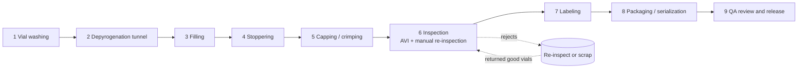

# Process map: aseptic liquid-vial fill-finish

Ticket T1.1.1 · Status of evidence: secondary and vendor sources unless marked **[primary]**. Items marked **VERIFY** are not confirmed and must not be quoted publicly. Source IDs (`[Sx]`) refer to `sources.md`. Rate ranges are intentionally **not** given here: no citable vials/min figure has been collected yet; T2.1.1 owns that.

## Flow

Upstream (out of scope): formulation/compounding, sterile filtration, stopper and cap preparation. Downstream (out of scope): warehousing and distribution.

## Step table

| # | Step | Purpose | Equipment (typical) | Flow type | Main downtime / loss causes | GMP control points |
|---|---|---|---|---|---|---|
| 1 | Vial washing | Remove particles and residues from glass before heat treatment | Rotary or ultrasonic washer; WFI and filtered-air rinses [S7, S8] | Continuous (indexed) | Jams, spray/nozzle issues, WFI or air supply faults (VERIFY relative frequency) | Water quality (WFI), washer cycle parameters, particulate limits |
| 2 | Depyrogenation | Heat-inactivate/remove endotoxin from glass | Dry-heat tunnel with hot-air zone and cooling zone; one design walkthrough cites roughly 250-350 °C for 5-7 min [S9, low confidence, VERIFY] | Continuous belt, fixed residence time | Belt/conveyor faults, temperature excursions, glass handling | Validated time/temperature, endotoxin-reduction qualification; what happens to vials on a stop is **VERIFY** |
| 3 | Filling | Dose product into vials | Filler (peristaltic, time-pressure or rotary piston) inside an isolator or RABS [S2, S7, S8] | Continuous or indexed | Dose adjustment, fill-weight failures, pump/needle faults, **interventions** | Grade A zone with unidirectional airflow; interventions designed, risk-assessed and qualified (Annex 1) [S2]; in-process fill-weight checks [S10] |
| 4 | Stoppering | Seat closure to seal the container | Pick-and-place or continuous stoppering, with or without vacuum [S7] | Continuous | Stopper feed/bowl jams, misplacement | Stopper-position checks [S10]; aseptic transfer of stoppers |
| 5 | Capping / crimping | Secure the closure with an aluminum cap | Continuous capper; external cleaning machine often follows [S8, S10] | Continuous | Cap feed, crimp-quality rejects | Crimp-quality and cap-roundness checks [S10]; container-closure integrity relevance |
| 6 | Inspection | Detect visible particles and container defects; verify closure | Automated visual inspection (AVI) machines; inline checks (empty vial, stopper position, crimp, print); semi-automated or manual re-inspection of rejects [S5, S10] | Continuous or batch-oriented; re-inspection is a separate manual loop | False rejects, recipe changes, camera/handling faults; inspector capacity for re-inspection | 100% inspection plus AQL sampling at release for visible particulates (USP <790>, <1790>) [S5]; inspector qualification (VERIFY details) |
| 7 | Labeling | Apply identity label | Labeler | Continuous | Label roll changes, print/vision rejects, label faults | Label control and reconciliation; line clearance for packaging and labeling, 21 CFR 211.130(e) [S3]; unlabeled-container handling 211.130(b) |
| 8 | Packaging / serialization | Cartoning, leaflet, serial number aggregation | Cartoner, serialization/aggregation | Continuous or intermittent | Serialization or vision rejects, carton feed (VERIFY whether better modeled as minor stoppage or separate loss) | Lot/control number traceability 211.130(c) [S3]; track-and-trace requirements (VERIFY, not yet sourced) |
| 9 | QA review and release | Review batch records and release batch | QA reviewers (people, not equipment) | Queue of batches | Backlog of records, discrepancy investigations | Quality unit reviews and approves production records before release or shipment, 21 CFR 211.192 [S4] |

### Line clearance nuance (important correction)
21 CFR 211.130(e) is a **packaging and labeling** requirement: inspect the facilities before use to confirm earlier product and unsuitable materials are removed, and document it in the batch record [S3]. Clearing the filling area before a new batch is also a GMP expectation, but the governing citation for it is **not** 211.130; candidates are 21 CFR 211.67 (equipment cleaning) and the aseptic-processing guidance [S1]. The model therefore uses the term *line clearance* for all stations but cites 211.130(e) only for labeling/packaging. **VERIFY the fill-area citation before it appears in the README.**

## Scope boundaries
**In:** liquid-filled vials, one line, the 9 steps above.
**Out:** lyophilization (a major real-world bottleneck for freeze-dried products but excluded), formulation, terminal sterilization, isolator bio-decontamination cycle modeling, media fills (aseptic process simulations) beyond a generic planned stop, deviation/CAPA workflows, environmental-monitoring excursions.

## Why these steps matter for the model
- Steps 1-5 are the aseptic core; steps 6-8 are where batch-to-batch label and inspection capacity limits often show up. Whether any is the constraint is an output, not an assumption.
- Interventions at the filler (step 3) are a downtime source with GMP weight: they are planned, risk-assessed events under Annex 1 [S2], so the model should treat them separately from random breakdowns (candidate refinement for T3.1.4).
- AVI false rejects (step 6) create a rework loop that consumes inspector time and affects Quality in OEE.

## Uncertain items for an SME (do not guess)
1. What happens to vials already in the depyrogenation tunnel when downstream stops: scrap, re-processing or slowed belt?
2. Typical AVI false-reject rate and what fraction of re-inspected rejects return to good stock.
3. Whether the capper and filler are usually a single integrated unit, and so should share a failure clock.
4. Which stations commonly carry accumulation buffers, and how large (vials) they are.
5. Typical size and structure of a QA release hold: batch-record review time versus laboratory release testing.
6. Which regulation or guidance sets fill-area line clearance expectations (see nuance above).
7. How serialization/aggregation stops are usually classified in OEE.
8. Is the external vial cleaning step between capping and inspection part of the capper, or a separate machine with its own failures? (Vendor material describes it as a separate machine [S10]; confirm.)
